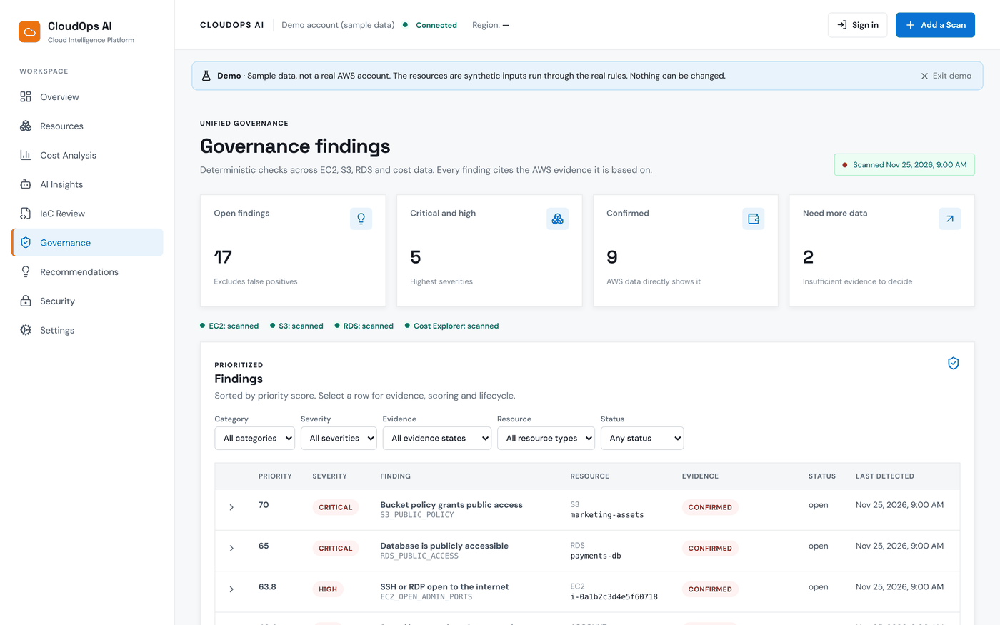
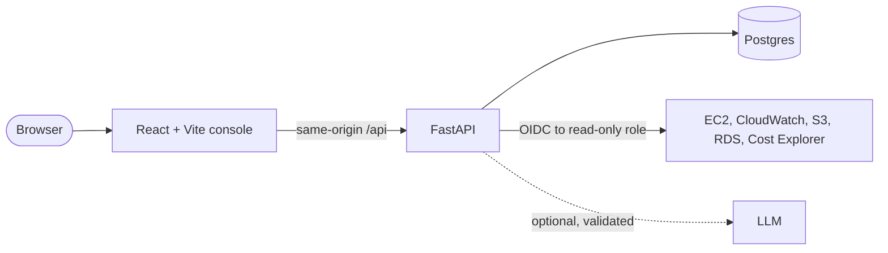

# CloudOps AI

[](https://github.com/jeevakumarr48/cloudops.ai/actions/workflows/cloudops-check.yml)

**Read-only AWS governance with explanations you can trust.** CloudOps AI scans EC2, S3, RDS and Cost Explorer with 21 deterministic rules, scores every finding with a transparent formula, cites the AWS evidence behind it, and turns it into a recommendation with copy-ready fix and undo commands. An optional language model may reword the advice, but a validator throws out anything it invents. CloudOps AI never changes your account.

**[Try the public demo](https://cloudops-ai-roan.vercel.app/?demo=1)** (sample data, no sign-in) · [Case study](docs/case-study.md) · [Architecture](docs/architecture.md) · [Decisions](docs/adr/README.md) · [Threat model](docs/threat-model.md) · [Changelog](CHANGELOG.md)



## Highlights

- **Evidence, not guesses.** Each finding is `CONFIRMED`, `POTENTIAL` or `INSUFFICIENT_EVIDENCE`. A denied permission is reported as unknown and names the action to grant; missing metrics are never read as zero.
- **AI that can't lie its way through.** Rules detect, a model only rewrites, and the validator rejects unseen figures, ids, savings claims and destructive advice. An offline evaluation in CI checks it.
- **Fix-first plan and fix commands.** Per-resource ordering and AWS CLI steps to record, change, verify and undo, each labelled `read_only`, `safe`, `disruptive` or `destructive`.
- **No AWS keys.** The API assumes a read-only role through Vercel OIDC, and the role, trust and Vercel projects are Terraform.
- **$0 a month.** Serverless hosting with database-counted caps on every billed API.

## Architecture



The details, sequence and deployment diagrams are in [docs/architecture.md](docs/architecture.md).

## Technology stack

| Area | Tools |
| --- | --- |
| Backend | Python 3.12, FastAPI, SQLAlchemy 2, Alembic, boto3, Argon2 |
| Frontend | React 19, Vite, axios, Recharts, Lucide |
| Data | Postgres (Neon) in production, SQLite for local work and tests |
| AI | Any OpenAI-compatible API or local Ollama, optional |
| Infrastructure | Vercel, AWS IAM with OIDC, Terraform, Docker, docker compose, nginx |
| Quality | pytest and coverage, Ruff, mypy, Vitest and Testing Library, Playwright, terraform test, pip-audit, npm audit, GitHub Actions |

## AWS integration

The backend only calls read APIs (17 actions, listed in [docs/iam](docs/iam/README.md)). Credentials come from, in order of preference, Vercel OIDC web identity, AssumeRole with an ExternalId, or the default boto3 chain for local work. The Security page shows which mode is active and whether long-lived keys are present.

## Terraform + Infracost workflow

Terraform plans are an input to review, never something this app applies:

```bash
terraform plan -out tfplan
terraform show -json tfplan > plan.json
infracost breakdown --path . --format json --out-file infracost.json
```

`POST /api/iac/analyze` (and `POST /api/governance/iac`, which returns the same unified findings) accepts the plan, optional metrics and Infracost JSON. `infrastructure/` holds sample artifacts for it. The app's own infrastructure lives separately in `infra/terraform` (see [Infrastructure as code](#infrastructure-as-code)).

## Console

Overview, Resources, Cost Analysis, AI Insights, IaC Review, Governance, Recommendations, Security, Operations and Settings. Pages that read the AWS account need a signed-in operator; signed-out visitors get the sample-data demo. Every page renders loading, unavailable and empty states instead of inventing metrics, costs or savings.

## API Endpoints

| Method | Path | Access | Purpose |
|---|---|---|---|
| GET | `/` | public | Service banner |
| GET | `/health` | public | Health check |
| GET | `/api/resources/ec2` | operator | EC2 inventory |
| GET | `/api/metrics/ec2` | operator | CloudWatch CPU metrics |
| GET | `/api/costs`, `/api/costs/forecast` | operator | Cost Explorer summary and forecast (billed; database-cached and capped) |
| GET | `/api/insights` | operator | Decision findings and explanations |
| GET | `/api/overview` | operator | Dashboard summary |
| GET | `/api/recommendations` | operator | Backward-compatible recommendation response |
| POST | `/api/iac/analyze` | public | Terraform plan and Infracost analysis of a submitted plan |

Endpoints that read the deployment's AWS account need a signed-in operator (`CLOUDOPS_OPERATOR_EMAILS`); signed-out visitors can use the public demo instead. Their responses are `private, no-store`, so a CDN never shares them. `CLOUDOPS_PUBLIC_SECURITY_FINDINGS=true` makes them public again (and re-enables CDN caching of cost responses) for a deployment that intends that. Unavailable AWS services return structured unavailable responses. The dashboard shows unavailable states instead of inventing metrics or costs.

## Project Structure

```text
backend/                 FastAPI application and tests
backend/services/        AWS, cost, metrics, IaC, rules, and AI services
frontend/                React/Vite dashboard
infrastructure/          Sample Terraform plan and Infracost artifacts the analyzer reviews
infra/terraform/         Terraform for the app's own IAM role, OIDC trust and Vercel projects
docs/                    Architecture, decision records, threat model, case study, release guide
.github/workflows/       Read-only CI checks
```

## Local Setup

### Docker (one command)

Requirements: Docker with Compose v2.

```bash
docker compose up --build        # or: make up
```

Open http://localhost:8080 (the demo is at http://localhost:8080/?demo=1). This runs Postgres 16, the API (migrations applied on start, non-root user) and the built frontend behind nginx, which proxies `/api` the same way `frontend/vercel.json` does in production. Register `operator@example.com` (or set `CLOUDOPS_OPERATOR_EMAILS`) to see the operator console. Without AWS credentials every source reports unavailable; to read your own account, uncomment the read-only `~/.aws` mount in `docker-compose.yml`. CI runs this same stack and the smoke test against it.

### Without Docker

Requirements: Python 3.12+, Node.js 22+, and optional read-only AWS credentials.

```bash
make install     # virtualenv, backend dev requirements, npm ci
make dev         # API on :8000 (SQLite, migrations applied) and Vite on :5173
make check       # ruff, mypy, backend tests with coverage, Vitest, evaluation
make e2e         # Playwright end-to-end tests
make help        # every target
```

On Windows without `make`, run the commands in the `Makefile` directly, for example:

```bash
python -m venv .venv
.venv\Scripts\activate
pip install -r backend/requirements-dev.txt
cd backend && python -m alembic upgrade head && python -m uvicorn main:app --reload --port 8000
# second terminal
cd frontend && npm ci && npm run dev
```

Copy `backend/.env.example` and `frontend/.env.example` to local environment files as needed. Environment files containing secrets are ignored by Git.

## Environment Variables

| Variable | Required | Purpose |
|---|---|---|
| AWS credential chain | For AWS data | Standard boto3 credentials and region |
| `VITE_API_URL` | No | Local development only: the API the Vite dev server proxies `/api` to (default `http://127.0.0.1:8000`). The browser always calls `/api` on its own origin. |
| `CLOUDOPS_AI_CORS_ORIGINS` | No | Comma-separated allowed frontend origins |
| `CLOUDOPS_AI_API_KEY` or `OPENAI_API_KEY` | No | Optional AI explanation provider |
| `CLOUDOPS_AI_BASE_URL` / `CLOUDOPS_AI_MODEL` | No | Optional provider configuration |
| `INFRACOST_API_KEY` | No | Optional Infracost integration marker |
| `CLOUDOPS_COST_CACHE_SECONDS` | No | In-process Cost Explorer cache lifetime, default 86400 (each CE request costs $0.01) |
| `CLOUDOPS_COST_CDN_SECONDS` | No | Vercel CDN cache lifetime for successful cost responses, default 86400 |
| `CLOUDOPS_INVENTORY_CDN_SECONDS` | No | Vercel CDN cache lifetime for EC2, metrics, insights and overview responses, default 60 |
| `CLOUDOPS_DISCOVERY_CACHE_SECONDS` | No | In-process EC2 DescribeInstances cache, default 60; 0 disables |
| `CLOUDOPS_AWS_ROLE_ARN` | No | Read-only role to use instead of stored keys (Vercel OIDC or AssumeRole); see docs/iam/README.md |
| `CLOUDOPS_AWS_EXTERNAL_ID` | No | ExternalId for AssumeRole mode |
| `CLOUDOPS_AWS_AUTH` | No | `auto` (default), `default`, `assume_role` or `oidc` |
| `CLOUDOPS_AI_PROVIDER` | No | Recommendation rewrite provider: `none` (default), `ollama`, `openai_compatible` |
| `CLOUDOPS_AI_DAILY_CALL_LIMIT` | No | Max AI provider calls per UTC day for recommendations, default 20 |
| `CLOUDOPS_AI_CACHE_SECONDS` | No | Reuse an LLM explanation for unchanged findings, default 3600 |
| `DATABASE_URL` | On Vercel, for accounts | Postgres URL (Neon pooled endpoint). Locally defaults to SQLite `backend/cloudops.db` |
| `CLOUDOPS_COOKIE_SECURE` | No | `false` only for local HTTP development; default `true` |
| `CLOUDOPS_SESSION_DAYS` | No | Session lifetime, default 7 |
| `CLOUDOPS_REGISTRATION_OPEN` | No | `false` disables self-registration |
| `CLOUDOPS_OPERATOR_EMAILS` | For S3 views | Comma-separated emails allowed to see the deployment account's security findings |
| `CLOUDOPS_PUBLIC_SECURITY_FINDINGS` | No | `true` serves S3 findings anonymously (demo accounts only); default `false` |
| `CLOUDOPS_S3_CACHE_SECONDS` | No | S3 scan cache lifetime, default 900 |
| `CLOUDOPS_CE_MONTHLY_CALL_LIMIT` | No | Hard monthly cap on billed Cost Explorer requests, default 75 ($0.75) |
| `CLOUDOPS_MAX_BODY_BYTES` | No | Largest request body accepted, default 2000000 (2 MB); larger requests get 413 |

## S3 discovery and governance

| Endpoint | Purpose |
|---|---|
| `GET /api/resources/s3` | Every bucket with region, versioning, encryption, Block Public Access, policy status, ACL, lifecycle, logging, CloudWatch storage metrics and a governance summary |
| `GET /api/resources/s3/{bucket}/governance` | All seven S3 rule evaluations for one bucket, with evidence |

Security posture is sensitive (a list of public buckets is a map for
attackers), so these endpoints are **not public** by default: they require a
signed-in user listed in `CLOUDOPS_OPERATOR_EMAILS`. Set
`CLOUDOPS_PUBLIC_SECURITY_FINDINGS=true` only for a demo account whose buckets
are safe to show. Responses are never CDN-cached.

Add `?refresh=true` to rescan (honoured at most once a minute). Results are
cached for 15 minutes (`CLOUDOPS_S3_CACHE_SECONDS`).

Each check reports `ok`, `not_configured`, `access_denied` or `error`. Each rule
returns one evidence state: `CONFIRMED`, `POTENTIAL`, `INSUFFICIENT_EVIDENCE`,
`NO_ISSUE` or `DATA_UNAVAILABLE`. Storage size comes only from CloudWatch's
daily `BucketSizeBytes`; a missing datapoint is `null`, never zero. No S3 rule
estimates savings.

| Rule | Category | Raised when |
|---|---|---|
| `S3_PUBLIC_POLICY` | SECURITY | AWS reports the bucket policy is public (CRITICAL, or MEDIUM if RestrictPublicBuckets blocks it) |
| `S3_PUBLIC_ACL` | SECURITY | ACL grants AllUsers/AuthenticatedUsers (HIGH, or LOW if IgnorePublicAcls applies) |
| `S3_BLOCK_PUBLIC_ACCESS` | SECURITY | Any of the four settings is off at both bucket and account level |
| `S3_DEFAULT_ENCRYPTION` | SECURITY | No default encryption rule |
| `S3_VERSIONING` | CONFIGURATION | Versioning disabled or suspended (low confidence; depends on data) |
| `S3_LIFECYCLE` | STORAGE | No lifecycle rules and at least 1 GiB stored or versioning on; insufficient evidence when size is unknown |
| `S3_ACCESS_LOGGING` | GOVERNANCE | Server access logging disabled |

The required permissions are in [`docs/iam/cloudops-readonly-policy.json`](docs/iam/cloudops-readonly-policy.json).

## RDS discovery and governance

| Endpoint | Purpose |
|---|---|
| `GET /api/resources/rds` | DB instances with engine, class, storage, Multi-AZ, public access, encryption, backups, deletion protection, tags, internet-open security group rules, 14 days of hourly CloudWatch metrics and a governance summary |
| `GET /api/resources/rds/{database_id}/governance` | All eight RDS rule evaluations for one database, with evidence |

Optional `?region=` (default region otherwise) and `?refresh=true` (once a
minute). Same access rule as S3: operator sign-in unless
`CLOUDOPS_PUBLIC_SECURITY_FINDINGS=true`.

| Rule | Category | Raised when |
|---|---|---|
| `RDS_PUBLIC_ACCESS` | SECURITY | Publicly accessible: CRITICAL if a security group allows 0.0.0.0/0 or ::/0 on the DB port, HIGH if groups are unreadable, MEDIUM if they are closed |
| `RDS_STORAGE_ENCRYPTION` | SECURITY | Storage not encrypted |
| `RDS_BACKUP_RETENTION` | AVAILABILITY | Retention 0 days (HIGH) or under 7 days |
| `RDS_MULTI_AZ` | AVAILABILITY | Production-tagged and single-AZ; insufficient evidence when untagged or Aurora |
| `RDS_DELETION_PROTECTION` | GOVERNANCE | Off on a production or untagged database |
| `RDS_LOW_UTILIZATION` | UTILIZATION | 14 days with at least 80% hourly coverage and CPU mean < 10%, p95 < 20%, peak < 40%. Production databases get LOW severity, low confidence and a review-only recommendation |
| `RDS_STORAGE_HEADROOM` | STORAGE | Free storage under 10% (or 20% without autoscaling), or over 80% unused on 100+ GiB |
| `RDS_GP2_STORAGE` | COST | gp2 storage; gp3 is usually cheaper per GB, difference not calculated |

Utilization is never judged on partial history, stopped instances or missing
metrics; those return `INSUFFICIENT_EVIDENCE` or `DATA_UNAVAILABLE`.

## Unified governance engine

One engine runs every deterministic rule across EC2, S3, RDS and Cost
Explorer, scores the findings and tracks their lifecycle.

| Endpoint | Purpose |
|---|---|
| `GET /api/governance/findings` | Active findings sorted by priority. Filters: `category`, `severity`, `evidence_state`, `resource_type`, `status`, `include_resolved` |
| `GET /api/governance/summary` | Counts by severity, category, resource type, evidence state and status, top 5 priorities, per-source status and the scoring formula |
| `PATCH /api/governance/findings/{finding_id}` | Set `open`, `acknowledged`, `accepted_risk` or `false_positive` with a note (signed-in operator only; audited) |
| `POST /api/governance/iac` | Terraform plan + optional metrics/Infracost as unified, scored findings (same input as `/api/iac/analyze`) |

The original `/api/insights` and `/api/recommendations` are unchanged.

**Every finding** carries `finding_id` (stable hash of resource type, rule and
resource), `rule_id`, `resource_type`, `resource_id`, `region`, `category`,
`severity` (CRITICAL to INFO), `evidence_state`, `title`, `description`, cited
`evidence`, `detection_source`, `recommendation`, `remediation_steps`,
`confidence`, `missing_information`, `requires_human_approval` (always true),
`priority` and `lifecycle` (`status`, `first_detected`, `last_detected`,
`resolved_at`, `times_reopened`).

**Lifecycle.** Findings are stored in the `governance_findings` table. When a
source scans successfully and a finding is no longer detected, it is resolved
automatically; if it comes back it reopens. A source that fails leaves its
findings untouched, so an outage never resolves anything.

**Priority score** (0 to 100, deterministic; the AI layer never changes it):

```
impact   = 0.45*S + 0.30*X + 0.25*F
priority = max(0, impact*C - P_effort - P_risk)
```

| Input | Values |
|---|---|
| S severity | CRITICAL 100, HIGH 75, MEDIUM 50, LOW 25, INFO 0 |
| X exposure | 100 confirmed internet exposure (critical/high), 60 potential, else 0 |
| F financial | 0 unless AWS or Infracost measured a dollar figure, then min(100, 20 x log2(1 + USD)) |
| C confidence | CONFIRMED 1.0, POTENTIAL 0.7, INSUFFICIENT_EVIDENCE 0.3 |
| P_effort, P_risk | low 0, medium 5, high 10 per rule; resizing a production resource is high risk |

New rules in this phase: `EC2_OPEN_ADMIN_PORTS` (SSH/RDP open to the internet
on a public instance), `EC2_STOPPED_INSTANCE`, `EC2_LOW_UTILIZATION` (14 days,
80% coverage, mean < 10% and peak < 40%), `EC2_MISSING_OWNER_TAG`,
`EC2_MISSING_ENVIRONMENT_TAG` and `COST_WEEKLY_INCREASE` (last 7 complete days
vs the 7 before: +25% and +$1 is MEDIUM, +100% and +$5 is HIGH). The cost rule
reuses the per-day series now included in `/api/costs?period=daily` (`daily`
field), so it makes no extra billed request.

After pulling this change, run `alembic upgrade head` again on production.

## AI recommendations

Every finding from the governance engine becomes a recommendation with the 12 required fields: title, resource, problem, evidence, why it matters, suggested action, expected benefits, potential risks, estimated savings, confidence, missing information and `requires_human_approval` (always `true`, enforced by the schema).

Pipeline: findings -> evidence bundle (finding, other findings on the same resource, the facts the text may mention) -> deterministic template -> optional AI rewrite -> validator -> stored per evidence hash.

- **Works with no AI at all.** Templates cover every rule; the default provider is `none`.
- **The AI only rewrites prose.** It may return problem, why it matters, action, benefits, risks and a correlation note, and must cite evidence ids. Severity, evidence state, priority score, confidence, savings and the resource always come from the rule engine.
- **Validator.** AI text is discarded (template used instead, violations recorded) if it cites unknown or no evidence, names resource ids or ARNs not in the evidence, states money, percentages, sizes or durations not in the evidence, claims savings or guarantees, makes security claims without a security finding (or asserts a breach on any resource), proposes automatic or unapproved changes, or contradicts the finding.
- **Savings** are shown only when a rule attaches a measured figure with its basis; nothing is estimated from list prices.
- **Cost control.** `GET /api/ai/recommendations` never calls a provider. `POST /api/ai/analyze` is user-triggered, handles at most 10 findings, skips evidence that already has an AI rewrite or was already rejected, and is capped per UTC day by `CLOUDOPS_AI_DAILY_CALL_LIMIT` (counted in the database). Without a database no provider call is made.
- **Ollama** (`CLOUDOPS_AI_PROVIDER=ollama`, default model `llama3.2:3b` at `http://localhost:11434/v1`) works only when the API runs on the same machine; a Vercel function cannot reach a laptop.

| Method | Path | Access | Purpose |
| --- | --- | --- | --- |
| GET | `/api/ai/recommendations` | operator | Recommendations (each with `fix` commands), a deterministic posture summary and a fix-first `plan` |
| GET | `/api/ai/status` | operator | Provider, model, calls used today (never the key) |
| POST | `/api/ai/analyze` | signed-in operator | AI rewrite of up to 10 findings (`finding_ids` or top `limit`) |
| POST | `/api/ai/recommendations/{id}/feedback` | signed-in operator | Record `accepted`, `rejected`, `remediation_in_progress` or `remediated_pending_verification`; changes nothing in AWS |

The legacy `/api/insights` explanation and its `ai_explainer` are unchanged.

### Fix commands and the fix-first plan

- **Fix commands.** Each recommendation for an S3, RDS, EC2 or cost rule carries `fix`: copy-ready AWS CLI commands built from the finding (resource id and region filled in, shell-quoted). They are grouped as *record the current state*, *make the change*, *check it worked* and *undo*, and every step is labelled `read_only`, `safe`, `disruptive` or `destructive`. Values that need a human decision (instance type, retention days, owner) stay as `<PLACEHOLDERS>`. CloudOps never runs them, never sends them to an AI provider, and omits them for findings with insufficient evidence and for Terraform findings (fix those in code).
- **Fix-first plan.** `plan` groups open findings by resource and orders the groups by most severe finding, highest priority score and number of findings. It explains a group only with the known cross-finding correlations and marks quick wins (one low-risk command on confirmed evidence). Accepted-risk, false-positive and resolved findings are left out. It is deterministic and costs nothing.

### Evaluating recommendations

`backend/evals` holds 10 scenarios built from realistic discovery records run through the real rules: a public unencrypted bucket, a fully hardened bucket (must produce nothing), a bucket whose checks are permission-denied (must be "unknown", never a finding), a public unencrypted production database, a database with only partial metric history, SSH open to the internet, a low-CPU production instance, a stopped untagged instance, a weekly cost increase, and a Terraform plan that upsizes a low-CPU instance. Each scenario carries a grounded rewrite that must be accepted and adversarial rewrites (invented costs, resources, ARNs and savings, asserted breaches, automatic changes, dismissive or overconfident wording, bad citations) that must be rejected by the intended check.

```bash
cd backend
python -m evals.run_eval                  # offline, no AWS or AI calls
python -m evals.run_eval --live           # also score the configured provider (one call per scenario)
python -m evals.run_eval --json report.json
```

The offline run is part of the test suite and must pass in full. Live results are reported, not asserted, since model output varies.

## Public demo

Open the frontend with `?demo=1` (or press **Try the demo**) to explore the Governance and Recommendations pages without an account or an AWS connection. The demo reads `/api/demo/*`, which runs the synthetic discovery inputs from `backend/evals/scenarios.py` through the real rules, scoring, recommendation templates, fix commands and fix-first plan. Every response is labelled `demo: true` with a sample-data notice, and a banner stays on screen.

The demo never reads AWS, never writes to the database and never calls an AI provider, and it has no write endpoints. Real findings stay behind operator sign-in. Pages that read live AWS data directly (Overview, Cost Analysis and the others) show a notice in demo mode. Turn it off with `CLOUDOPS_DEMO_ENABLED=false`.

| Method | Path | Notes |
|---|---|---|
| GET | `/api/demo/governance/summary` | Same shape as `/api/governance/summary` |
| GET | `/api/demo/governance/findings` | Same filters as `/api/governance/findings` |
| GET | `/api/demo/ai/recommendations` | Templates, fix commands and plan; no AI |
| GET | `/api/demo/ai/status` | Always reports no provider |

## Governance console

The sidebar has two signed-in pages next to the original ones (which are unchanged):

- **Governance**: summary counts, per-source scan status (an unavailable source is shown as unavailable, never as "no issues"), filters by category, severity, evidence state, resource type and status, and a prioritized findings table. Each row expands to evidence, missing information, the priority formula and its inputs, and lifecycle. Operators can set a status (acknowledged, accepted risk, false positive) with a note.
- **Recommendations**: a deterministic posture summary, then one card per finding showing the 12 required fields in order, the correlation note, and any validator violations. Operators can record a decision and, when an AI provider is configured, run the optional rewrite for the top 5 findings or a single card.

Sign-in uses the HttpOnly session cookie, so these pages call the API on the same origin: through the `/api` rewrite in `frontend/vercel.json` in production and through the Vite dev proxy locally (`npm run dev` proxies `/api` and `/health` to `VITE_API_URL`). Pages load data when opened or refreshed; nothing polls. A governance scan is reused for 60 seconds, so the pages share one round of AWS reads.

## Observability

Built in and free: no paid monitoring service, and no database write per request.

- **Structured logs.** Every API log line carries the request id that is also returned in the `X-Request-ID` header, so one request can be followed through the Vercel log viewer. `CLOUDOPS_LOG_FORMAT=json` (the default on Vercel) writes one JSON object per line; locally the default is readable text. `CLOUDOPS_LOG_LEVEL` sets the level. Access logs record the method, route template, status and duration only: never query strings, bodies, cookies or headers, so ids, passwords and tokens stay out of logs.
- **Health checks.** `GET /health` is liveness. `GET /health/ready` is readiness: it answers 503 when a configured database does not respond. The Docker image's health check uses it.
- **Scan history.** Each real governance scan (scans are reused for 60 seconds) stores its duration, finding count and per-source status and timing in `scan_runs`, pruned to the latest 200 rows.
- **Operations page** (`GET /api/ops/status`, operators only). Build and commit, database latency, AWS credential mode and AI provider; the Cost Explorer and AI budgets against their caps; per-source success rate and average scan time; and request count, p50/p95 latency, server errors and 503s for the current instance. Loading it makes no AWS or AI call.

## Request security

- **Origin check.** A POST, PATCH, PUT or DELETE that carries the session cookie must come from an origin in `CLOUDOPS_AI_CORS_ORIGINS` or from the API's own origin (or, with no Origin header, must not be marked cross-site by the browser). Otherwise it is refused with `403 origin_not_allowed`. This adds to SameSite=Lax cookies and the JSON-only rule. The deployed frontend origin must be listed in `CLOUDOPS_AI_CORS_ORIGINS`.
- **Errors.** Errors raised by the API share one envelope: `{"status": "error", "error": "<message>", "code": "<code>", "request_id": "...", "detail": ...}`. `detail` keeps FastAPI's field for existing clients; the original endpoints' `{"status": "unavailable", "error": "..."}` bodies are unchanged. Unexpected errors return `internal_error` without internal details, and every response has an `X-Request-ID` header to match logs.
- **Headers.** API responses send `nosniff`, `DENY` framing, `no-referrer`, a deny-all CSP (except the `/docs` page) and HSTS when cookies are Secure; `/api/auth` responses are `no-store`. The frontend sends `nosniff`, `DENY` framing and a strict referrer policy (`frontend/vercel.json`).
- **Operator views.** `GET /api/security/status` shows the AWS credential mode and whether long-lived keys are in use (never key material). `GET /api/security/audit` lists the deployment's audit events. Both need a signed-in operator and appear on the console's Security page.
- **AWS credentials.** See `docs/iam/README.md` for Vercel OIDC federation (no stored keys) and AssumeRole with ExternalId.

## Accounts, workspaces and the database

The original dashboard endpoints stay public and read-only. Accounts and
workspaces are additive:

| Endpoint | Purpose |
|---|---|
| `POST /api/auth/register` | Create an account and a personal workspace (you are its admin) |
| `POST /api/auth/login` / `POST /api/auth/logout` | Start or end a session (HttpOnly, SameSite=Lax cookie) |
| `GET /api/auth/me` | Current user and workspace memberships |
| `GET /api/workspaces`, `POST /api/workspaces` | List or create workspaces |
| `GET /api/workspaces/{id}` | Workspace and members (members only) |
| `POST /api/workspaces/{id}/members` | Add a registered user as `admin` or `viewer` (admins only) |
| `GET /api/workspaces/{id}/audit` | Recent audit events (admins only) |

Passwords are hashed with Argon2id; session tokens are stored only as SHA-256
digests. Non-members receive 404 for another workspace. Login and registration
are rate limited in the database.

Locally nothing needs configuring: a SQLite file is created and migrated on
first use. In production set `DATABASE_URL` and migrate explicitly:

```bash
cd backend
DATABASE_URL="postgresql://..." alembic upgrade head
```

Cost Explorer results are also stored in the database so every serverless
instance shares them, and billed requests are capped per month
(`CLOUDOPS_CE_MONTHLY_CALL_LIMIT`). When the cap is reached the most recent real
snapshot is served; nothing is estimated.

## Testing and quality gates

Every push and pull request runs these in CI (`.github/workflows/cloudops-check.yml`). None of them need AWS credentials or an AI provider.

| Gate | Tool | Command (run locally) |
|---|---|---|
| Lint, including security rules | ruff (pyflakes, pycodestyle, isort, bugbear, bandit, simplify) | `cd backend && ruff check . ../scripts` |
| Types | mypy | `cd backend && mypy .` |
| Backend tests, coverage must stay at or above 90% | pytest, pytest-cov | `cd backend && python -m pytest tests --cov=.` |
| Recommendation quality (grounding, rejection of invented figures) | offline evaluation | `cd backend && python -m evals.run_eval` |
| Migrations apply and match the models | Alembic | `alembic upgrade head && alembic check` |
| Dependency vulnerabilities | pip-audit, npm audit | `pip-audit -r backend/requirements.txt`, `npm audit --omit=dev` |
| Frontend lint | ESLint | `cd frontend && npm run lint` |
| Unit and component tests | Vitest, Testing Library | `cd frontend && npm test` |
| End-to-end, desktop and phone | Playwright against the real API on SQLite | `cd frontend && npm run test:e2e` |
| Platform infrastructure as code: format, validate, tests with mocked providers | terraform fmt / validate / test | `make tf-check` (never applies) |

Install the tools with `pip install -r backend/requirements-dev.txt` and `npm ci`. The end-to-end run starts the API with fake AWS credentials and `AWS_ENDPOINT_URL` pointed at a closed local port, so no request can reach AWS. Modules that predate type checking (older discovery and rule code) are listed as type debt in `backend/pyproject.toml`.

## Infrastructure as code

The app's own access is managed with Terraform in [`infra/terraform`](infra/terraform/README.md): the Vercel OIDC identity provider, a read-only IAM role whose trust is pinned to the API project's production environment, and the two Vercel projects with their non-secret settings. All of it is free. A precondition fails the plan if the policy ever gains an action that is not `Describe`, `Get` or `List`. CI validates and tests it with mocked providers; only you run `apply`.

## Deployment

For the governance release (database, operator setup, preview, production, rollback and cost guardrails) follow [docs/RELEASE.md](docs/RELEASE.md). `scripts/smoke_test.py <url>` is a read-only post-deploy check.

Deploy the services separately. Start the backend with:

```bash
uvicorn main:app --host 0.0.0.0 --port $PORT
```

Set `CLOUDOPS_AI_CORS_ORIGINS` to the deployed frontend origin. The frontend calls `/api` on its own origin and `frontend/vercel.json` rewrites it to the API, so the session cookie is first-party; do not point `VITE_API_URL` at the API in production. The frontend is a static Vite build (`npm run build`, output in `frontend/dist`). No deployment step runs Terraform or changes AWS infrastructure.

## Security

See the [threat model](docs/threat-model.md). In short: read-only IAM, no long-lived AWS keys with OIDC, Argon2id passwords, hashed session tokens in an `HttpOnly` first-party cookie, an origin check on every state-changing request, rate limits, an audit log, and security headers. Never commit `.env` files, AWS keys, Terraform state, plan files or provider secrets.

## Limitations

- Scans cover the deployment's own AWS account. Workspaces can register customer roles, but scanning them is not built yet.
- Covered services: EC2, CloudWatch CPU, S3, RDS, Cost Explorer and Terraform plans. IAM, CloudTrail, Lambda and Kubernetes are not.
- The validator matches patterns; it cannot catch every subtle misstatement written in plain words.
- Scans run on request, not on a schedule.

More detail is in [docs/RELEASE.md](docs/RELEASE.md#6-known-limitations).

## Future scope

Scanning workspace accounts, scheduled scans with change notifications, more AWS services, and a second cloud provider. Automatic remediation is deliberately out of scope ([ADR 0001](docs/adr/0001-read-only-recommendation-only.md)).
