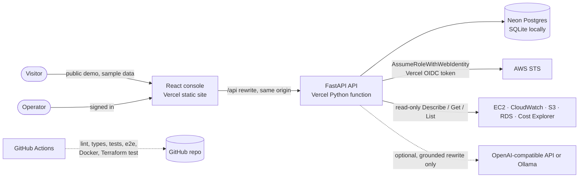
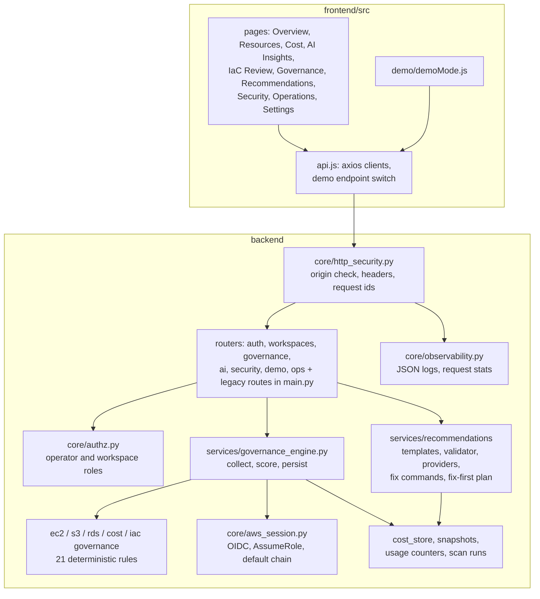
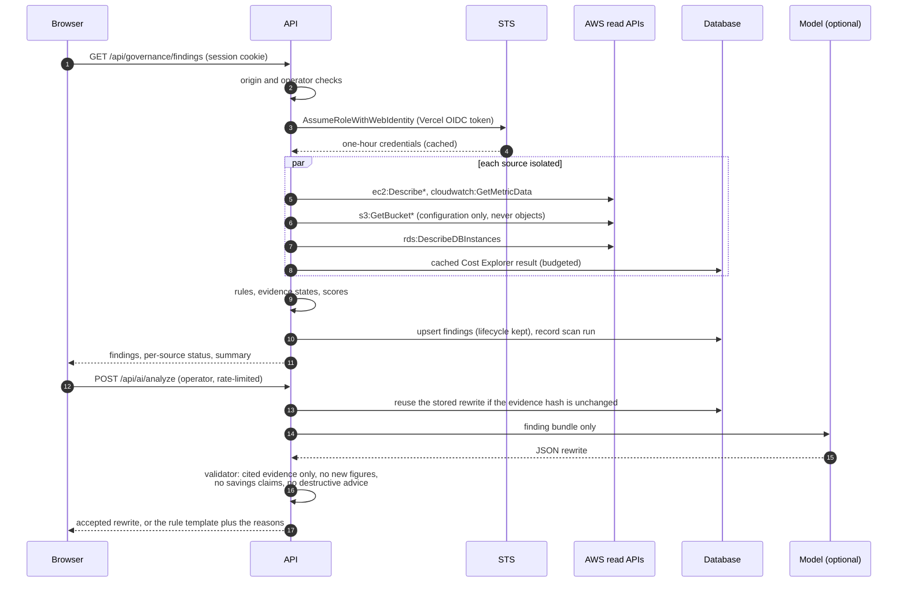
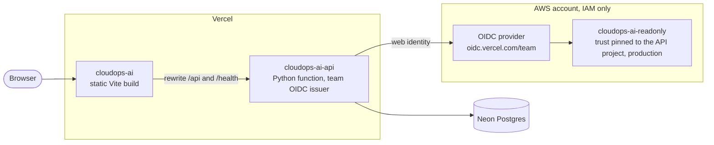
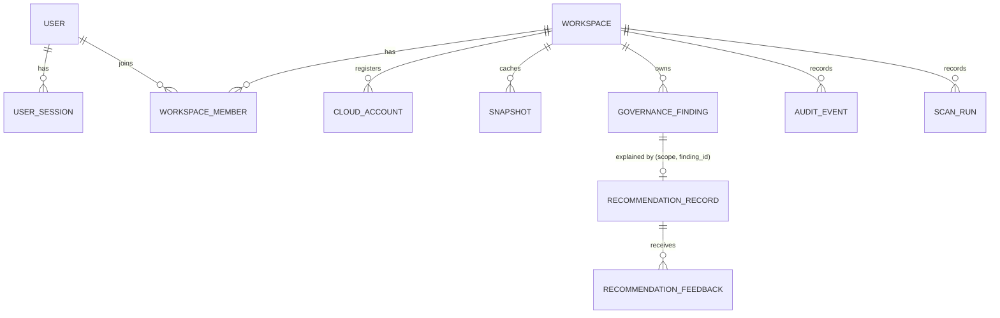

# CloudOps AI architecture

CloudOps AI is a read-only governance and decision-support system. It turns AWS
configuration, metrics, cost data and Terraform plans into scored findings with
cited evidence, explains them, and leaves every change to a human. The reasons
behind the design are in [the decision records](adr/README.md); the security
view is in [the threat model](threat-model.md).

## System context

Nothing in the picture can change the AWS account. The role holds only read
actions ([ADR 0001](adr/0001-read-only-recommendation-only.md)), and the model
sees finding bundles, never credentials, raw AWS responses or tools.

## Components

| Layer | Responsibility | Key files |
| --- | --- | --- |
| HTTP | Origin check on state-changing requests, security headers, request id, timing | `core/http_security.py` |
| Identity | Argon2id passwords, SHA-256-hashed session tokens, rate limits, audit events | `core/security.py`, `routers/auth.py` |
| Authorization | Operators for the deployment's own account, roles inside workspaces | `core/authz.py` |
| Collection | One scan per source (EC2, S3, RDS, cost), each isolated so one failure cannot hide the others | `services/governance_engine.py` |
| Detection | 21 rules that emit findings with evidence and an evidence state | `services/*_governance.py` |
| Scoring | `max(0, (0.45·S + 0.30·X + 0.25·F)·C − P_effort − P_risk)`, every input returned | `governance_engine.score` |
| Recommendations | Rule templates, optional model rewrite, validator, fix commands, fix-first plan | `services/recommendations/` |
| Persistence | Users, workspaces, findings and lifecycle, recommendations, feedback, snapshots, usage counters, scan runs, audit events | `core/models.py`, `migrations/` |
| Operations | Readiness, budgets, scan history, latency | `routers/ops.py`, `core/observability.py` |

## A scan, end to end

Missing data is never treated as a pass or a zero. A permission error makes a
rule report `DATA_UNAVAILABLE` or `INSUFFICIENT_EVIDENCE` and name the action
to grant, and the source shows as unavailable
([ADR 0003](adr/0003-evidence-states-not-booleans.md)).

## Deployment

The two projects and the IAM pieces are Terraform in
[`infra/terraform`](../infra/terraform/README.md); CI tests it with mocked
providers and never applies. Locally, `docker compose up` runs the same API on
Postgres behind nginx ([ADR 0007](adr/0007-serverless-hosting-at-zero-cost.md)).

## Data model

Rows with no workspace belong to the deployment's own AWS account (the
`global` scope). `usage_counters` stands alone: fixed-window counters for
budgets and rate limits, so no Redis is needed. A cloud account stores only a
role ARN and ExternalId, never keys.

## Cost controls

| Spend | Control |
| --- | --- |
| Cost Explorer ($0.01 per call) | Database cache shared by all instances; monthly cap `CLOUDOPS_CE_MONTHLY_CALL_LIMIT` (default 75) |
| Model calls | Off by default; operator-only, 10 per user per hour, `CLOUDOPS_AI_DAILY_CALL_LIMIT` (default 20), stored per evidence hash so a refresh never calls again |
| CloudWatch, S3 GET-class requests | Scan cache (60 s) and discovery caches; the public demo never touches AWS |
| Hosting | Vercel Hobby, Neon free tier, IAM and STS are free; no always-on compute |

The Operations page shows each budget's use for the current period.
