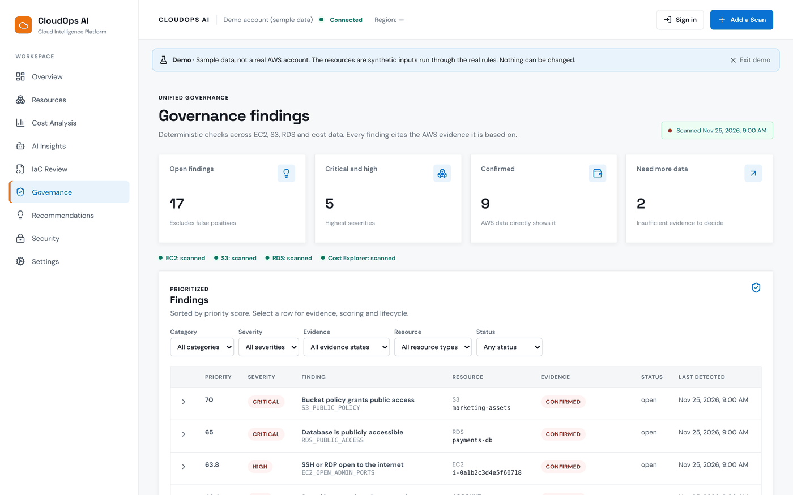
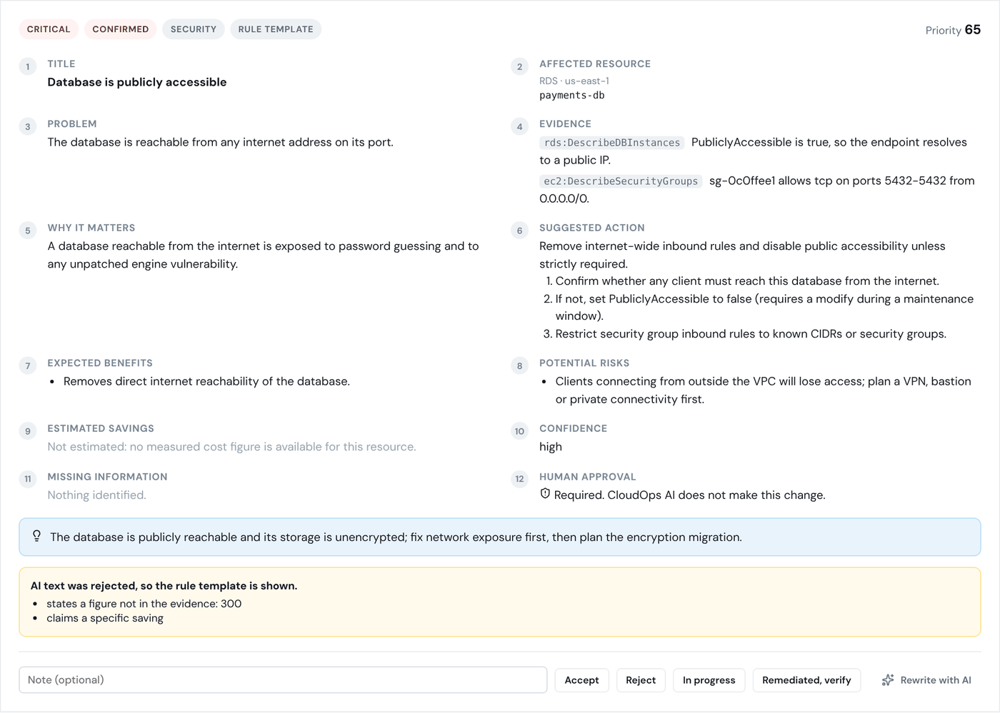
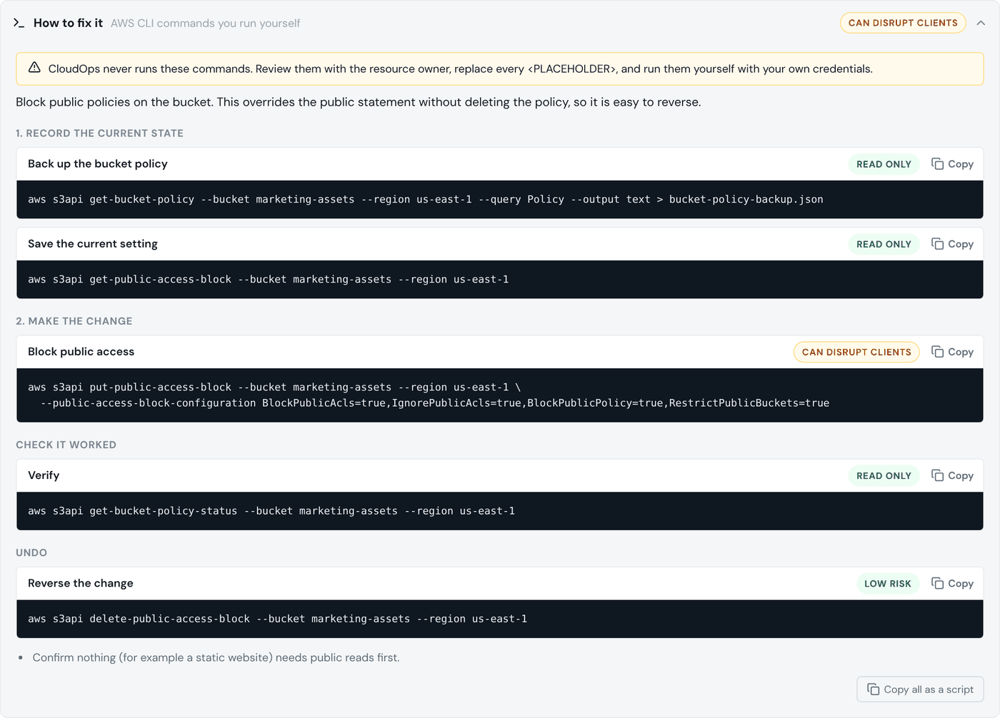
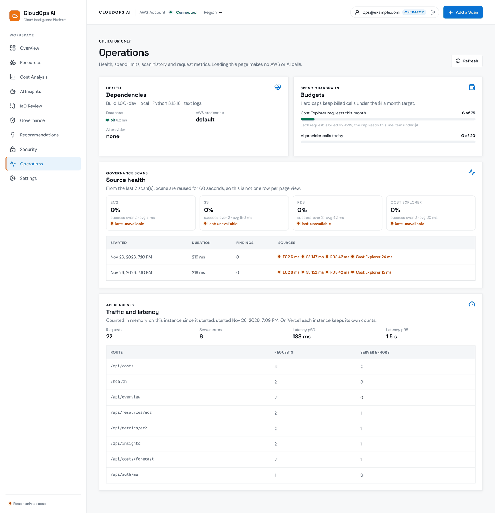
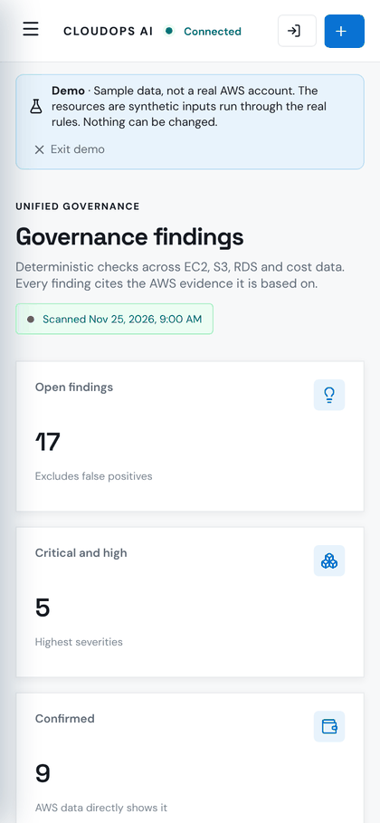

# Case study: CloudOps AI

**Live:** [console](https://cloudops-ai-roan.vercel.app) · [public demo](https://cloudops-ai-roan.vercel.app/?demo=1) · [API health](https://cloudops-ai-api.vercel.app/health)

## The problem

Cloud accounts drift. A bucket policy gets loosened for a test, a database is
made public "for an hour", an instance is left running at 3% CPU. Existing
tools either flood teams with pass/fail checks that cannot tell "compliant"
from "we could not check", or bolt a chatbot onto the inventory and let it
invent savings figures.

The goal was a tool a cautious engineer would actually connect to a real
account: it explains what is wrong, why, what to do first and how to undo it,
and it cannot change anything itself.

## Constraints

| Constraint | Effect on the design |
| --- | --- |
| Read-only, recommendation-only | 17-action IAM policy of `Describe`, `Get` and `List`; fix commands are text ([ADR 0001](adr/0001-read-only-recommendation-only.md)) |
| No fabricated data | Evidence states and `DATA_UNAVAILABLE` instead of guesses ([ADR 0003](adr/0003-evidence-states-not-booleans.md)) |
| $0 a month target, $1 ceiling | Serverless hosting, database-counted budgets for billed APIs ([ADR 0007](adr/0007-serverless-hosting-at-zero-cost.md)) |
| No AWS keys in the hosting platform | OIDC web identity with a trust pinned to one project ([ADR 0004](adr/0004-short-lived-aws-credentials-via-oidc.md)) |
| AI must be optional and safe | Rules detect, the model only rewrites, a validator gates it ([ADR 0002](adr/0002-rules-detect-model-explains.md)) |

## What was built

- **Unified governance engine** across EC2, S3, RDS and Cost Explorer: 21
  deterministic rules, a transparent priority score whose inputs are returned
  with every finding, and a lifecycle (open, acknowledged, accepted risk, false positive,
  resolved) kept across scans.
- **Terraform plan review** with Infracost cost impact, merged into the same
  findings.
- **Recommendations** with problem, evidence, impact, risks and confidence, and
  an optional model rewrite that is discarded if it invents anything.

- **Fix commands and a fix-first plan.** Copy-ready AWS CLI steps (record
  state, change, verify, undo), each labelled by impact, and a per-resource
  plan that explains what to fix first.

- **Accounts and workspaces** with server-side sessions, operator roles and an
  audit log.
- **Public demo** that runs sample inputs through the real rules, so anyone
  can explore it without an AWS account
  ([ADR 0008](adr/0008-demo-runs-sample-data-through-real-rules.md)).
- **Operations page** with budget use, per-source scan health, scan history
  and p95 latency.

## Engineering practice

| Area | What is in place |
| --- | --- |
| Testing | 349 backend tests (pytest, coverage floor 90%, currently about 93%), 19 Vitest component tests, 11 Playwright end-to-end tests on desktop and a phone viewport, 15 Terraform tests with mocked providers |
| AI quality | Offline evaluation of 10 scenarios with grounded and adversarial rewrites; CI fails if a fabricated figure, ARN or saving gets through |
| Static checks | Ruff (including security rules), mypy, ESLint, Alembic model/migration drift check |
| Supply chain | `pip-audit`, `npm audit`, Terraform provider lock file |
| Delivery | GitHub Actions: backend, frontend, end-to-end, Terraform and a Docker job that runs the whole stack on Postgres and a smoke test |
| Local setup | `make install && make dev`, or `docker compose up` for API, console and Postgres |
| Observability | JSON logs with request ids, readiness probe, request metrics, scan history |
| Infrastructure as code | Terraform for the app's own IAM role, OIDC trust and Vercel projects; CI tests it and never applies |
| Security | [STRIDE threat model](threat-model.md), CSRF origin check, security headers, rate limits, Argon2id, hashed session tokens |

## Hard parts

**Saying "we don't know" without crying wolf.** A denied `GetBucketPolicyStatus`
is neither a pass nor a finding. Evidence states let the engine say exactly
that, name the permission to grant, and still rank the finding by how sure it
is. Missing CloudWatch datapoints stay missing instead of becoming 0% CPU.

**Letting a model help without letting it lie.** The validator compares every
sentence of a rewrite with the evidence: unknown numbers, ids, ARNs, savings
claims, asserted breaches and destructive advice are rejected, and the rule's
own text is shown with the reasons. The evaluation suite holds both sides: good
rewrites must pass, and adversarial ones must fail for the intended reason.

**Spending pennies safely on serverless.** In-memory counters reset on every
cold start, so the Cost Explorer and model budgets are counted in Postgres.
The worst-case monthly bill is bounded in code, and the Operations page shows
how much of each budget is used.

**Commands built from untrusted strings.** Bucket names and tags come from
whoever controls the scanned account. Fix commands quote every value and
validate regions, and the app never runs them.

## Results

- Runs at $0 a month on Vercel Hobby and Neon's free tier, with code-level caps
  keeping the worst case near $1.
- No long-lived AWS keys once OIDC is enabled.
- Every finding cites the AWS call and observation it is based on.

## What's next

- Scan customer accounts registered in workspaces (the model and role
  storage exist; scans still cover the deployment's own account).
- Scheduled scans and change notifications.
- More services (IAM, CloudTrail, Lambda) and a second cloud.
