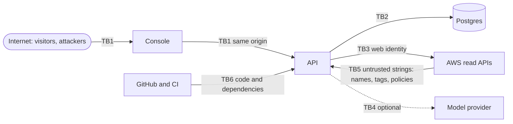

# Threat model

Scope: the CloudOps AI console, API, database, its AWS role and its optional
model provider, as deployed on Vercel and Neon (see
[architecture](architecture.md)). Method: STRIDE per trust boundary. Reviewed
2026-11-26.

## What is worth protecting

| Asset | Why it matters |
| --- | --- |
| Findings about the connected AWS account | A map of public buckets, open ports and unencrypted databases is an attacker's to-do list |
| The AWS role | Read access to account configuration and billing data |
| User passwords and sessions | Operator sessions unlock the account's findings |
| Spend | Cost Explorer and model calls are billed; an attacker can try to run up the bill |
| Secrets: `DATABASE_URL`, model API key | Full database access; billed model usage |

## Trust boundaries

TB5 matters: resource names, tags and policies in the scanned account are
written by whoever controls that account, so the API treats them as untrusted
input to the UI, the fix commands and the model prompt.

## Threats and mitigations

| ID | STRIDE | Threat | Mitigation | Where | Status |
| --- | --- | --- | --- | --- | --- |
| S1 | Spoofing | Password guessing or credential stuffing | Argon2id hashes, rate limits per IP and per email, failed logins audited, registration can be closed | `core/security.py`, `routers/auth.py` | Mitigated |
| S2 | Spoofing | Stolen session token | `HttpOnly`, `Secure`, `SameSite=Lax` cookie; only the SHA-256 digest is stored; logout deletes the session | `routers/auth.py`, `core/security.py` | Mitigated |
| S3 | Spoofing | Another Vercel project or a preview deployment assumes the AWS role | Trust pinned by `sub` to one project and environment, plus audience | `infra/terraform/aws` | Mitigated |
| T1 | Tampering | Cross-site request forgery | State-changing requests must carry an allowed `Origin` or `Sec-Fetch-Site: same-origin`; JSON content type required | `core/http_security.py`, `core/authz.py` | Mitigated |
| T2 | Tampering | A signed-in non-operator changes finding status | Lifecycle changes require an operator; every change is audited with the user | `routers/governance.py` | Mitigated |
| T3 | Tampering | Prompt injection through a resource name or tag (TB5) | The model has no tools and no credentials; its output is text that must pass the validator (no unseen ids or figures, no destructive advice) or it is discarded; findings and fix commands never come from the model | `services/recommendations/` | Mitigated |
| T4 | Tampering | Shell injection through a crafted bucket or instance name in a copied fix command | Every value is `shlex`-quoted; regions must match a strict pattern; commands are never run by the app | `services/recommendations/fix_commands.py` | Mitigated |
| R1 | Repudiation | A user denies a sign-in or a status change | Audit events with user, action and short hashes of IP; request ids in JSON logs | `core/security.audit`, `core/observability.py` | Mitigated |
| I1 | Information disclosure | Signed-out visitors read the account's findings, inventory or costs | Live AWS endpoints require an operator; responses are `private, no-store` so no CDN shares them; the public demo is separate sample data | `core/authz.py`, `main.py`, `routers/demo.py` | Mitigated |
| I2 | Information disclosure | Credentials or secrets in logs or error responses | Logs record method, route template, status and timing, never headers or bodies; errors use a fixed envelope without stack traces or provider messages | `core/observability.py`, `core/http_security.py` | Mitigated |
| I3 | Information disclosure | Account data sent to a third-party model | Model off by default; only the finding bundle is sent; a local Ollama keeps everything on the machine | `services/recommendations/providers.py` | Mitigated (opt-in) |
| I4 | Information disclosure | The role reads data, not just configuration | Policy has no object or secret reads; Terraform fails the plan if one is added | `docs/iam`, `infra/terraform/aws` | Mitigated |
| I5 | Information disclosure | Script injection in the console steals data | React escapes output; API sends a strict CSP; console sends `nosniff`, `DENY` framing and a referrer policy | `frontend/vercel.json` | Partial: console has no CSP yet |
| D1 | Denial of service / wallet | Repeated requests run up Cost Explorer or model bills | Monthly Cost Explorer cap and daily model cap counted in the database; model analysis is operator-only and limited to 10 per user per hour; results cached | `services/cost_store.py`, `services/recommendations/service.py` | Mitigated |
| D2 | Denial of service | Oversized plan JSON posted to the public IaC analysis endpoints | Vercel caps request bodies at 4.5 MB; analysis is pure computation | `main.py`, `routers/governance.py` | Partial: no app-level size limit |
| E1 | Elevation of privilege | The app's AWS access grows to write actions | Read-only allowlist enforced by a Terraform precondition and tests; the app has no IAM permissions to change its own role | `infra/terraform/aws` | Mitigated |
| E2 | Elevation of privilege | Any registered user becomes an operator | Operators are an explicit email allowlist (`CLOUDOPS_OPERATOR_EMAILS`); workspace admin actions check the membership role | `core/authz.py` | Mitigated |
| E3 | Elevation of privilege | A compromised dependency or CI step | `pip-audit` and `npm audit` in CI; Terraform provider lock file; CI has read-only repo permissions and no cloud credentials | `.github/workflows` | Partial: actions pinned by tag, not commit SHA |

## Residual risks and follow-ups

- **I5:** add a Content-Security-Policy to the console (`frontend/vercel.json`
  and `frontend/nginx.conf`).
- **D2:** reject request bodies over a fixed size in the API before parsing.
- **E3:** pin GitHub Actions to commit SHAs and let Dependabot update them.
- The validator matches patterns. It cannot catch every subtle misstatement
  written in plain words (see `docs/RELEASE.md`, known limitations).
- Rate limits use fixed windows, so a burst at a window edge can reach twice
  the limit for a moment.
